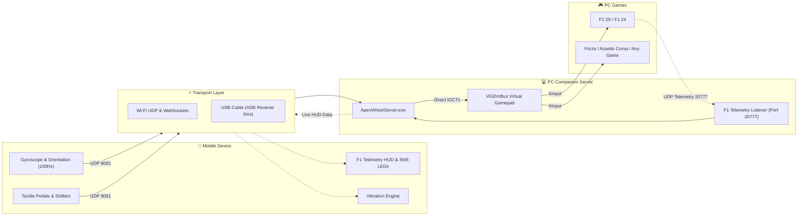

# 🏎️ ApexWheel F1

[](LICENSE)
[](#)
[](#)
[-purple.svg)](#)

> **Turn your smartphone into an authentic Formula 1 Steering Wheel & Universal Sim Racing Controller for PC.**

ApexWheel is a high-performance, ultra-low latency system that turns any Android smartphone into a full-featured Formula 1 steering wheel and gamepad. It bridges live **EA Sports F1 25 / F1 24 UDP Telemetry** with your phone's screen and gyroscope, giving you an authentic cockpit experience with shift lights, gear display, DRS/ERS controls, and paddle shifters.

---

## 🌟 Key Features

- **🏎️ Authentic Formula 1 Wheel Cockpit**:
  - **15 Shift LEDs**: 5 Green $\rightarrow$ 5 Red $\rightarrow$ 5 Blue flashing shift points.
  - **Large Gear Readout**: Real-time gear display (`N`, `R`, `1` through `8`).
  - **Digital Speedometer**: Speed in KM/H.
  - **DRS Status Indicator**: Visual notification when DRS is available and active.
  - **ERS Battery Gauge**: Live battery storage percentage and deployment modes.
  - **4-Corner Tyre Temperatures**: Real-time thermal monitoring for Front-Left, Front-Right, Rear-Left, and Rear-Right tires.
  - **Tactile Paddle Shifters**: Downshift (`LB`) and Upshift (`RB`) with haptic vibration feedback.
  - **F1 Controls**: DRS button, ERS / Overtake boost, Pit Limiter, Brake Bias (+/-), and Differential adjustments.

- **🎮 Universal Game Compatibility**:
  - Emulates an **Xbox 360 Controller** via the open-source **ViGEmBus** driver.
  - Works out of the box with **100% of PC games**:
    - *EA Sports F1 25 / F1 24 / F1 23 / F1 22*
    - *Assetto Corsa / Assetto Corsa Competizione*
    - *Forza Horizon 5 / Forza Motorsport*
    - *BeamNG.drive*
    - *EA Sports WRC / Dirt Rally 2.0*
    - *Need for Speed / GTA V / Rocket League / Any PC Game*

- **⚡ Dual Connection (Wi-Fi + USB)**:
  - **Wi-Fi Mode**: Wireless freedom over local Wi-Fi with auto-discovery.
  - **USB Mode**: Connect phone with USB cable via ADB reverse port forwarding for **0ms latency**.

- **📱 Multiple Presets**:
  1. **F1 Steering Wheel Mode**: Live telemetry LCD + shift lights + F1 buttons + paddle shifters.
  2. **GT / Sim Racing Mode**: Clean racing wheel with large progressive pedals and sequential shifter.
  3. **Universal Gamepad Mode**: Dual analog sticks, D-pad, ABXY face buttons, and triggers.

---

## 🏗️ System Architecture



---

## 🚀 Quick Start Guide

### Step 1: Install Virtual Controller Driver (One-time)
Run `install_drivers.bat` (or run `drivers\ViGEmBus.exe`) to install the signed Windows virtual controller driver.

### Step 2: Start the PC Companion Server
Double-click `start_server.bat` (or run `server\ApexWheelServer.exe`).
The server will start listening for phone inputs on port `8081` and F1 25 telemetry on port `20777`.

### Step 3: Connect Your Phone
- **Option A (APK)**: Install the native Android APK (`android/app/build/outputs/apk/debug/app-debug.apk`) on your phone.
- **Option B (Browser)**: Open `http://<your-laptop-ip>:8080` in your phone's browser (Chrome or Safari).

### Step 4: Configure F1 25 Telemetry
Inside F1 25:
1. Go to **Settings** $\rightarrow$ **Telemetry Settings**.
2. Set **UDP Telemetry**: `On`.
3. Set **UDP Port**: `20777`.
4. Set **UDP Send Rate**: `60Hz`.

Jump into a time trial or race, and feel the wheel in your hands!

---

## 📁 Repository Structure

```
F1Wheel/
├── server/                     # C# PC Companion Server
│   ├── ApexWheelServer.cs      # Core server with ViGEm + F1 Telemetry + Input bridge
│   └── ApexWheelServer.exe     # Standalone compiled executable (zero dependencies)
├── android/                    # Native Android APK Project
│   ├── app/src/main/           # Native SensorManager + UDP socket + WebView
│   └── build.gradle            # Gradle build configuration
├── client-web/                 # F1 Wheel Web Dashboard & PWA
│   ├── index.html              # Authentic F1 cockpit layout
│   ├── style.css               # LED rev lights & carbon fiber styling
│   └── app.js                  # Gyro steering, pedals, and telemetry updater
├── drivers/                    # Driver installers
│   └── ViGEmBus.exe            # Official ViGEmBus driver installer
├── docs/                       # Guides
│   ├── F1_25_TELEMETRY_SETUP.md
│   └── USB_TETHERING_GUIDE.md
├── start_server.bat            # 1-Click companion server launcher
├── install_drivers.bat         # 1-Click driver installer
├── LICENSE                     # MIT License
└── README.md
```

---

## 📄 License
MIT License. Free to use, customize, and distribute.
